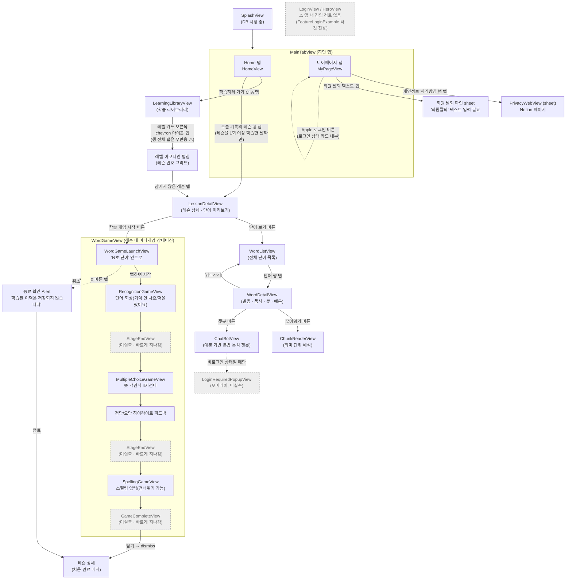

# FiveVoca 화면 플로우

Appium(appium-mcp) + iOS 시뮬레이터(iPhone 16, iOS 26.2)로 앱을 직접 조작하며 캡처한
화면 전환 문서입니다. 캡처 일자: 2026-09-17 / 커밋: `dev` 브랜치 작업 트리(uncommitted 변경 포함).

> 이 문서는 정적 코드 분석이 아니라 **실제 시뮬레이터 조작 결과**를 기준으로 작성했습니다.
> 코드만으로 추정한 전환과 실제 동작이 다른 부분은 "⚠️ 실측 노트"로 별도 표시했습니다.

## 전체 화면 플로우 (Mermaid)

> GitHub의 Mermaid 렌더러는 노드 안 HTML(``)을 보안상 지원하지 않습니다.
> 스크린샷이 포함된 다이어그램은 아래 [HTML 미리보기 만들기](#html-미리보기-만들기)로
> 로컬에서 열어서 보세요. 이 블록은 GitHub/텍스트 기준 다이어그램입니다.



## HTML 미리보기

`docs/screen-flow-preview.html`을 브라우저로 직접 열면 화면 흐름을
텍스트 노드로 표시한 Mermaid 다이어그램을 볼 수 있습니다.

```
open docs/screen-flow-preview.html
```

## ⚠️ 실측 중 발견한 사항

1. **학습 라이브러리 레벨 카드는 행 전체가 아니라 오른쪽 chevron 아이콘만 탭이 됩니다.**
   `LearningLibraryViewModel.didTapLevel`은 push 네비게이션이 아니라 `expandedLevelIDs`를
   토글하는 아코디언 방식이며, 현재 작업 중인 디버그 로그(`LevelCard.debugLog`,
   `SeedDebugLog.swift`)와 관련된 부분이라 추정됩니다. 행 전체를 탭하면 아무 반응이 없어
   처음엔 막힌 화면으로 보였습니다.
2. **StageEndView / GameCompleteView는 실제 스크린샷 캡처에 실패했습니다.** 진행을 빠르게
   시키기 위해 연속 탭을 했더니 두 화면 모두 다음 상호작용 좌표와 겹쳐 순간적으로
   지나갔습니다. Mermaid에서는 점선 노드로 표시했습니다.
3. **ChatBot의 로그인 유도 팝업(LoginRequiredPopupView)도 미실측입니다.** 테스트에 사용한
   시뮬레이터 계정이 이미 Apple로 로그인된 상태(`마이페이지 → "Apple로 로그인됨"`)라
   비로그인 분기를 재현하지 못했습니다.
4. **Login 피처 모듈(`Projects/Feature/Login`)은 실제 앱에서 도달할 수 없습니다.**
   `FeatureLoginExample` Example 타깃에서만 쓰이고, `MainTabView`/`HomeView` 등 어디서도
   참조되지 않습니다. 로그인은 마이페이지의 "Apple로 로그인" 버튼과 챗봇 진입 시 팝업,
   두 진입점만 실제로 존재합니다.
5. **홈 캘린더의 레슨 기록 행**은 레벨 아코디언을 거치지 않고 `LessonDetailView`로 직접
   진입하는 별도 경로입니다(레슨을 1회 이상 학습한 날짜에만 노출).
6. **회원 탈퇴 확인 sheet는 실제로 탈퇴시키지 않고 "취소"로 안전하게 빠져나왔습니다**
   (파괴적 동작이라 실행하지 않음).

## 도구 / 재현 방법

- 앱 빌드·실행: `mcp__XcodeBuildMCP__build_run_sim` (scheme `FiveVoca`, 시뮬레이터 `iPhone 16` / iOS 26.2)
- 화면 조작: `appium-mcp` (`select_device` → `prepare_ios_simulator` → `appium_session_management create`,
  이후 `appium_find_element` + `appium_gesture`)
- 스크린샷: `mcp__XcodeBuildMCP__screenshot` (Appium 자체 스크린샷 툴은 뷰어 리소스가 함께 반환되어
  컨텍스트를 크게 차지하므로 사용하지 않음)
- 번들 ID: `com.kangdev.threevoca`
