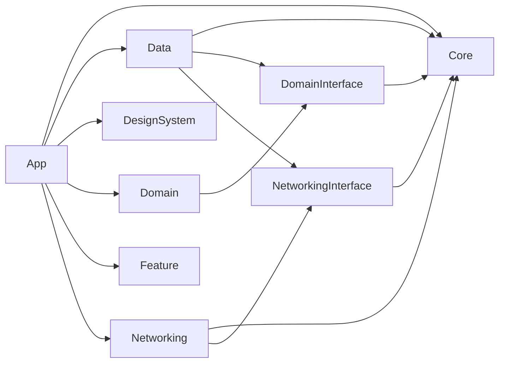

# Clean Architecture

레이어의 책임과 의존 방향, Repository·UseCase·데이터 모델의 경계를 정의한다.

## 레이어 구조와 의존 방향

다음은 Tuist 타겟 그래프에서 앱과 기반 타겟의 직접 의존을 추린 것이다. `Feature`는 집계 타겟으로 표시한다. 화살표 `A → B`는 A가 B를 참조한다는 뜻이다. 외부 패키지와 Tests·Example 타겟은 제외했다. 실제 선언은 각 `Projects/**/Project.swift`에서 확인한다.

### 앱과 기반 타겟

## Repository / UseCase 패턴

| 구성 요소 | 선언/구현 위치 | 책임 |
|---|---|---|
| Repository 계약 | `Projects/Domain/Interface/Repository/` | 데이터·시스템 기능을 struct-of-closures로 추상화 |
| Repository 구현 | `Projects/Data/Sources/<영역>/` | API·저장소·시스템 호출, 데이터 조합·매핑·캐시 |
| UseCase 계약 | `Projects/Domain/Interface/UseCase/` | 화면에서 사용하는 복합 동작의 계약 |
| UseCase 구현 | `Projects/Domain/Sources/UseCase/` | Repository 호출 조합과 도메인 처리 |
| LocalDataSource | `Projects/Data/Sources/<영역>/` | 담당 데이터의 로컬 조회·저장 |
| RemoteDataSource | `Projects/Data/Sources/<영역>/` | 네트워크 요청·응답 수신·스트림 전송 처리 |

DataSource와 UseCase의 활용 방법은 [예시](clean-architecture/examples.md)를 참고한다.

## 데이터 모델: DTO → Domain Model

- 외부 데이터 형식은 Data에 머물고, 도메인 경계에서 Domain Model로 변환한다.
- Domain Model은 화면 기술과 분리된 의미 있는 값을 표현한다.
- 화면에 필요한 표현은 Feature에서 파생하고, 화면과 무관한 공통 규칙은 DomainInterface에 둔다.

데이터 모델의 활용 방법은 [예시](clean-architecture/examples.md)를 참고한다.
